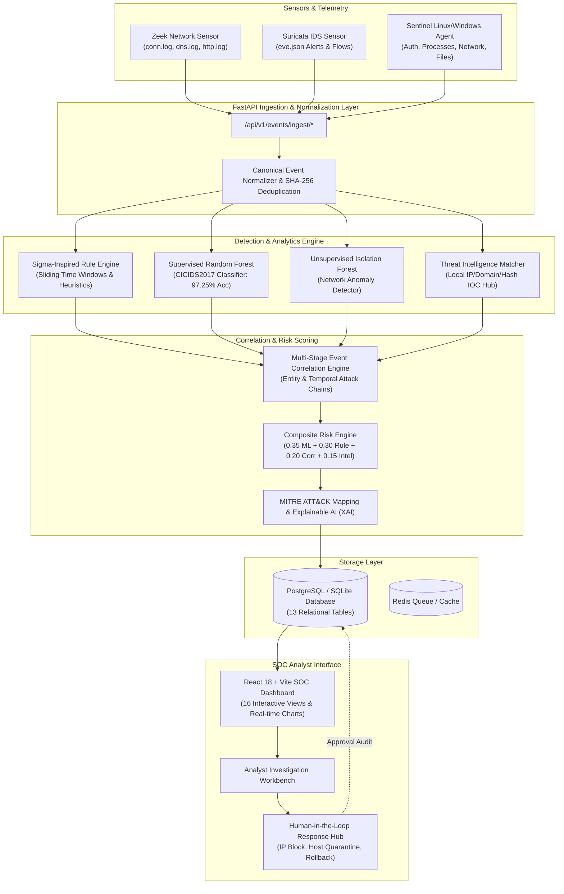

# SentinelAI System Architecture

## 1. High-Level Architecture Overview

SentinelAI is an enterprise-grade AI-powered Security Operations Centre (SOC) platform that monitors network telemetry and endpoint activity, identifies threats using rule-based heuristics and machine learning models, correlates multi-stage attack chains, calculates explainable threat risk scores (0–100), and provides an analyst-approved defensive response workflow.

---

## 2. Component Breakdown

### 2.1 Ingestion & Normalization Layer
- **FastAPI Endpoints**: High-throughput async endpoints receiving telemetry from Zeek, Suricata, and endpoint agents.
- **Canonical Schema**: Normalizes diverse sensor formats into a uniform model: `event_source`, `event_type`, `timestamp`, `source_ip`, `destination_ip`, `source_port`, `destination_port`, `protocol`, `host_id`, `username`, `process_name`, `process_pid`, `raw_data`, `normalized_data`.
- **Idempotency & Deduplication**: Generates deterministic SHA-256 checksums to reject duplicate logs within sliding windows.

### 2.2 Detection Engines
1. **Rule Engine**: Evaluates sliding windows and frequency thresholds using Sigma-inspired YAML rules (RULE-001 through RULE-008).
2. **Supervised Random Forest**: Trained on the calibrated CICIDS2017 intrusion benchmark (100 estimators, max depth 16) with 97.25% test accuracy.
3. **Unsupervised Isolation Forest**: Trained solely on benign baseline flows to flag anomalous feature shifts without requiring historical attack labels.
4. **Threat Intelligence Engine**: Matches telemetry against active indicators of compromise (IOCs) with severity weighting and expiry checks.

### 2.3 Event Correlation & Risk Scoring
- Correlates isolated events sharing common host, source IP, or user attributes within a 600-second window.
- Detects multi-stage attack chains (e.g. Brute Force -> Successful Authentication -> Shell Execution -> C2 Outbound Traffic).
- Automatically synthesizes incidents linked to primary event evidence.
- Calculates an explainable composite risk score from 0 to 100 with component weighting.

### 2.4 Human-in-the-Loop Defense Response
- Enforces strict analyst authorization before any containment command is dispatched.
- Demonstrates simulated host network isolation and IP drop rules in an isolated lab environment.
- Supports complete rollback of executed actions with immutable audit logging.
