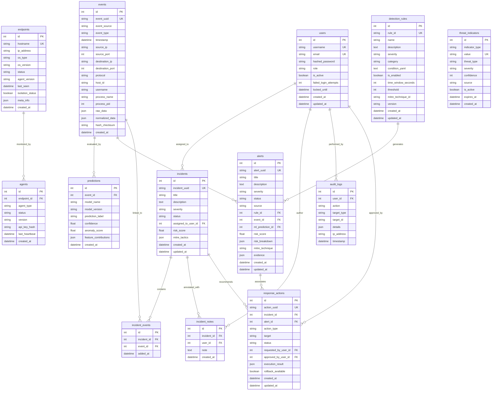

# SentinelAI Database Schema Documentation

SentinelAI utilizes PostgreSQL (with SQLite compatibility for offline laboratory testing) orchestrated via SQLAlchemy ORM and Alembic schema migrations.

---

## Entity Relationship Diagram (ERD)

---

## Table Descriptions

1. **`users`**: Platform analysts and administrators. Passwords hashed with Argon2/bcrypt. Supports failed login counter and lockout expiration.
2. **`endpoints`**: Fleet hosts registered for agent telemetry and quarantine tracking.
3. **`agents`**: Installed sensor agents with heartbeat monitoring and API keys.
4. **`events`**: Canonical security telemetry repository with deduplication hashes.
5. **`predictions`**: Supervised and unsupervised inference output associated with each event.
6. **`detection_rules`**: Sigma-inspired YAML heuristics and sliding threshold configurations.
7. **`alerts`**: High-priority security warnings with explainable risk breakdown.
8. **`incidents`**: Multi-stage correlated security investigations.
9. **`incident_events`**: Cross-reference mapping between incidents and linked telemetry events.
10. **`incident_notes`**: Analyst workbench log notes and hypothesis tracking.
11. **`response_actions`**: Approval-controlled defensive actions (IP block, host quarantine).
12. **`threat_indicators`**: Locally maintained indicators of compromise (IOCs).
13. **`audit_logs`**: Immutable audit trails recording analyst actions and system modifications.
